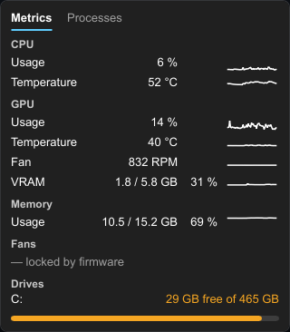

<p align="center">
  
</p>

<h1 align="center">Computer Stats</h1>

<p align="center">
  A tiny Windows tray app that shows how your PC is doing — CPU, GPU, memory, disks and
  temperatures — one click away, and lets you end the program that is slowing it down.
</p>

<p align="center">
  <a href="https://github.com/DiulianoVargas/computer-stats/releases/latest"><b>Download the latest release</b></a>
</p>

<p align="center">
  
</p>

## Why

Task Manager is heavy to open just to check a temperature, and most monitoring tools are big,
bloated or full of ads. Computer Stats lives in the system tray, uses about **4 MB of memory and
0.05 % CPU**, and shows everything in a small panel next to the clock.

## Features

- **Everything at a glance** — CPU usage and temperature, GPU usage and temperature, VRAM, memory
  and free space on every internal drive, updated every second.
- **60-second graphs** next to each value, so you can tell a spike from a sustained load.
- **Warnings by color** — values turn amber or red when memory is almost full, a disk is running
  out of space or a temperature is too high, and a colored dot appears on the tray icon so you
  notice it without opening anything. No pop-ups, no sounds.
- **Processes tab** — every running program with its icon, CPU and memory use, sorted by CPU or
  memory. Click **End**, then **Confirm?**, to close a program that is stuck or hogging the PC.
- **Desktop widget (optional)** — CPU, GPU and memory with their graphs, drawn straight on your
  wallpaper. Turn it on from the tray menu and drag it anywhere. It stays behind your windows
  and comes back where you left it. Off by default.
- **Start with Windows** — one click in the tray menu; starts at sign-in without a UAC prompt.
- **Light and dark theme**, any taskbar position, multiple monitors and high-DPI screens.
- **Native and lightweight** — written in Rust with a natively rendered UI: no browser engine, no
  background services, no network access, no telemetry.

## Install

1. Download **`ComputerStats-Setup-<version>.exe`** from the
   [latest release](https://github.com/DiulianoVargas/computer-stats/releases/latest).
2. Run it. Windows may show **"Windows protected your PC"** because the installer is not
   code-signed: click **More info → Run anyway**.
3. Keep **"Install PawnIO"** ticked if it is offered — it is the driver that lets the app read the
   CPU temperature (downloaded from its official publisher and verified).
4. Computer Stats starts and its icon appears in the tray (it may hide under the **^** arrow; drag
   it to the taskbar to keep it visible).

Prefer not to install? Download **`ComputerStats-<version>-portable.zip`**, unzip it anywhere and
run `computer-stats.exe` (install PawnIO from [pawnio.eu](https://pawnio.eu) for CPU temperature).

**Requirements:** Windows 10 (1809) or Windows 11, 64-bit.

## How to use

| Do this | To |
|---------|----|
| **Left-click** the tray icon | Open or close the Panel |
| Click **Metrics** / **Processes** (or **Ctrl+Tab**) | Switch tabs |
| Click the **CPU** or **Memory** header | Sort the Processes tab |
| Click **End**, then **Confirm?** within 3 s | Close a program (all its processes) |
| Click outside the Panel or press **Esc** | Close the Panel |
| **Hover** the tray icon | See which value needs attention |
| **Right-click** the tray icon | *Start with Windows*, *Show desktop widget* or *Quit* |
| **Drag** the desktop widget | Move it; it remembers the place |

### Warning levels

| Value | Amber at | Red at |
|-------|----------|--------|
| Memory | 80 % | 90 % |
| VRAM | 85 % | 95 % |
| Disk space used | 85 % | 95 % (only red affects the tray dot) |
| CPU temperature | 80 °C | 90 °C |
| GPU temperature | 80 °C | 87 °C |

## What your PC needs for each value

| Value | Works with |
|-------|------------|
| CPU usage, memory, disks | Any PC |
| GPU usage, temperature, VRAM | Any dedicated GPU (NVIDIA, AMD, Intel Arc) — read from Windows itself, like Task Manager. Integrated graphics are ignored. |
| CPU temperature | **AMD Ryzen** and **Intel** CPUs, with the [PawnIO](https://pawnio.eu) driver installed and the app running as administrator |

When something can't be read, the Panel shows `—` and the reason (`no GPU`, `driver not found`,
`unsupported CPU`, …) and everything else keeps working.

### Why it asks for administrator rights

Windows has no built-in way for programs to read the CPU's real temperature, so Computer Stats uses
the signed **PawnIO** driver, which only works for programs running as administrator. That is the
only reason the app asks for elevation. Turning on **Start with Windows** registers a scheduled
task, so the app starts elevated at sign-in without a UAC prompt.

## Resource use

Measured on a Ryzen 9 7900 with Windows 11 and about 300 running processes:

| | Memory | CPU |
|---|---|---|
| Panel closed | ~4–5 MB | 0.04 % |
| Panel open (Metrics) | ~4 MB | 0.03 % |
| Panel open (Processes) | ~7 MB | 0.13 % |
| Download size | 5.9 MB installer · 9 MB executable | |

## Safety and privacy

- **No network access** at all (the installer downloads PawnIO only if you tick it).
- **Ending programs is forced**, like Task Manager's *End task*: unsaved work in that program is
  lost. Any program can be ended, **including Windows' own** (for example *Service Host*); doing so
  can make Windows unstable or restart it. That is why every End needs a second click.
- Before ending a process, the app checks it is still the same process it listed, so a recycled
  process ID can never make it close the wrong program.

## Troubleshooting

- **The tray icon isn't visible** — open the hidden-icons arrow (**^**) next to the clock; drag the
  icon onto the taskbar.
- **CPU temperature shows `— not elevated`** — start the app as administrator (the Start menu
  shortcut and *Start with Windows* already do).
- **`— driver not found`** — install PawnIO from [pawnio.eu](https://pawnio.eu) (Official edition)
  and restart the app.
- **`— unsupported CPU`** — CPU temperature is available for AMD Ryzen and Intel CPUs only.
- **The app closed unexpectedly** — please open an
  [issue](https://github.com/DiulianoVargas/computer-stats/issues) and attach
  `%LOCALAPPDATA%\Computer Stats\crash.log`.

## Uninstall

**Settings → Apps → Installed apps → Computer Stats → Uninstall.** This also removes the *Start
with Windows* task. PawnIO stays installed (other programs may use it); remove it separately if you
want.

---

## For developers

### Build and run

Requirements: [Rust](https://rustup.rs) (stable, MSVC toolchain), Visual Studio Build Tools with
the Windows SDK, and [`cargo-deny`](https://github.com/EmbarkStudios/cargo-deny).

```powershell
cargo fmt --check
cargo clippy --all-targets -- -D warnings
cargo deny check
cargo test
cargo build --release
```

The executable asks for elevation (`highestAvailable`), so run `cargo run` or the built exe from an
**elevated** terminal — or set `$env:__COMPAT_LAYER = 'RunAsInvoker'` to run it without elevation
(CPU temperature then shows `— not elevated`). For CPU temperature during development, copy
`AMDFamily17.bin` or `IntelMSR.bin` from [PawnIO.Modules](https://github.com/namazso/PawnIO.Modules/releases)
next to the exe.

Debug builds also accept:

| Variable | Effect |
|----------|--------|
| `COMPUTER_STATS_TEST_THRESHOLD_OFFSET=<n>` | Lower every warning threshold by `n` to see the colors |
| `COMPUTER_STATS_TEST_VIEW=processes` | Open on the Processes tab |

and use their own single-instance lock, so they run next to an installed copy.

### Measure resource use

```powershell
.\scripts\measure.ps1 -Minutes 10            # Panel closed
.\scripts\measure.ps1 -Minutes 10 -PanelOpen # Panel open
```

The script fails if the app exceeds its budgets (30 MB / 0.5 % CPU closed, 45 MB / 2 % open,
10 MB executable).

### Package a release

```powershell
winget install JRSoftware.InnoSetup   # once
.\scripts\package.ps1
```

Produces `dist\ComputerStats-Setup-<version>.exe` (Inno Setup, EN/PT-BR) and
`dist\ComputerStats-<version>-portable.zip`. The exe is self-contained (static C runtime, icon and
version info embedded). The script downloads PawnIO.Modules, verifies each module against a pinned
SHA-256, and collects all third-party notices. The app icon is generated in code
(`cargo run --example make_icon`).

### How the project is organized

The project is built spec-first with [Spec Kit](https://github.com/github/spec-kit): every feature
has a specification, a plan, research notes and a task list before any code.

| Path | What |
|------|------|
| [`CONTEXT.md`](CONTEXT.md) | Glossary — the words used in specs, UI and code |
| [`.specify/memory/constitution.md`](.specify/memory/constitution.md) | Non-negotiable principles (resource budgets, native only, unsafe isolation, …) |
| [`docs/adr/`](docs/adr/) | Architecture decisions (Rust + Slint, running elevated, GPU via Windows instead of NVML) |
| [`specs/`](specs/) | One folder per feature: spec, plan, research, data model, UI contract, tasks, measurements |
| `src/domain/` | Pure logic (warning levels, graphs, formatting, decoding) — unit-tested, no I/O |
| `src/platform/` | The only place with `unsafe`: Win32, D3DKMT, PawnIO, process enumeration |
| `ui/` | The Slint UI |

| Feature | Spec |
|---------|------|
| 001 — CPU temperature spike | [`specs/001-cpu-temp-spike`](specs/001-cpu-temp-spike) |
| 002 — Tray icon and Metrics panel | [`specs/002-tray-metrics-panel`](specs/002-tray-metrics-panel) |
| 003 — Processes tab with End App | [`specs/003-processes-view`](specs/003-processes-view) |
| 004 — Intel CPU temperature, PawnIO from the installer | [`specs/004-intel-cpu-temperature`](specs/004-intel-cpu-temperature) |

## License

Computer Stats is released under the [MIT License](LICENSE). Third-party components keep their own
licenses (below).

## Third-party

- [Slint](https://slint.dev), used under the
  [Slint Royalty-free Desktop, Mobile, and Web Applications License 2.0](https://slint.dev/terms-and-conditions#royalty-free).
- [PawnIO.Modules](https://github.com/namazso/PawnIO.Modules) (`AMDFamily17.bin`, `IntelMSR.bin`),
  LGPL-2.1, shipped unmodified.
- [PawnIO](https://pawnio.eu) by namazso — not bundled; downloaded from its publisher on request.
- Rust crates under MIT/Apache-2.0 and similar licenses; the full list with license texts ships as
  `licenses\rust-crates.txt`.

[](https://slint.dev)
